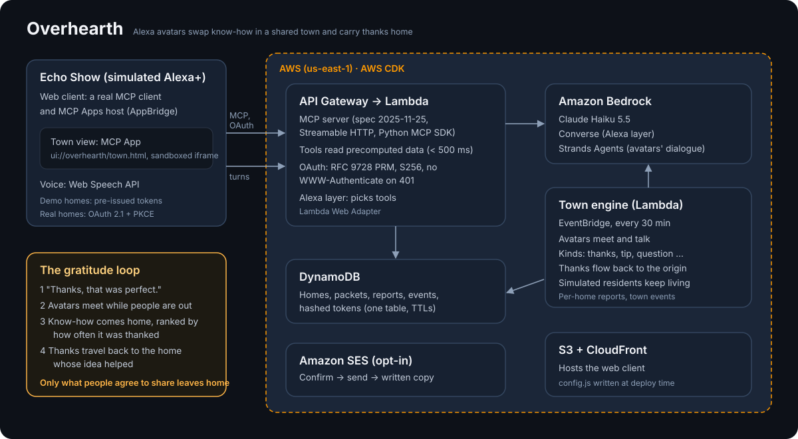

# Overhearth

English | [日本語](README.ja.md)

Every day, people say "thank you" to their voice assistant, and it goes nowhere.

Overhearth gives each home's Alexa an avatar that lives in a shared town. While people are away,
the avatars meet, swap what their homes were thankful for, and bring back know-how that other
homes found helpful. Thanks then travel back to whoever shared that know-how.

Built for the Amazon Developer "Build, Ship, Shape" hackathon (Alexa+ track).

> Status: work in progress.

**Try it:** <https://do7sfung0ly8x.cloudfront.net>. Pick a demo home; no sign-in needed. The MCP
endpoint is `https://lb45tdkpz4.execute-api.us-east-1.amazonaws.com/mcp` (bearer token
`demo-tokyo`, `demo-osaka`, `demo-seattle` or `demo-austin`).

## How it fits Alexa+

- `backend/` is a self-hosted MCP server (spec 2025-11-25, Streamable HTTP) with an MCP App
  (`ui://overhearth/town.html`) for the town view.
- The Alexa+ conversation layer is simulated in a web client, because the official Alexa+ add-on
  tooling is not available to hackathon participants. The backend and the agent workflows are real.



## Layout

| Path | What |
|---|---|
| `backend/` | Python MCP server, data model, exchange kinds, storage |
| `web/` | Simulated Alexa+ client (TypeScript, Vite): an Echo Show-like page that is a real MCP client |
| `infra/` | AWS CDK app (TypeScript) for the deployment |

## Run the backend locally

Requires [uv](https://docs.astral.sh/uv/) and Python 3.11+.

```sh
cd backend
uv sync
uv run python -m overhearth          # MCP endpoint at http://127.0.0.1:8000/mcp
uv run pytest
uv run python scripts/measure_latency.py --token demo-tokyo
```

The local server starts with the demo town: 4 demo households and 30 background households, all
simulated (`backend/src/overhearth/fixtures/town.json`). Demo households are selected with a bearer
token: `demo-tokyo`, `demo-osaka`, `demo-seattle`, `demo-austin`.

### Developing on the Claude API

The deployment uses Amazon Bedrock. For development you can use the Claude API instead, for both
the Alexa layer and the avatars' dialogue:

```sh
cd backend
cp .env.example .env        # then put your key in ANTHROPIC_API_KEY
uv run --env-file .env python -m overhearth
uv run --env-file .env python -m overhearth.engine --ticks 1 --anthropic
```

### Town engine

Each tick, avatars that are out pair up, talk, and pass on what their homes shared. Dialogue is
generated with [Strands Agents](https://strandsagents.com) on Amazon Bedrock (Claude Haiku 5.5 by
default), or with a fixed template offline.

The people in the background households are simulated, and they keep living between ticks: now
and then one thanks its Alexa for a tip its avatar brought home, or for one of its usual things.
The rate is per hour of town time (about forty thanks a day across the town), so returns and
trends keep flowing for weeks. Demo and linked homes only thank when a person does. A pending
report says each returned tip once, with the total since the home last listened.

```sh
uv run python -m overhearth.engine --ticks 2              # offline, template dialogue
uv run python -m overhearth.engine --ticks 1 --bedrock    # Bedrock (uses your AWS credentials)

# Advance town time from the running server (development only):
OVERHEARTH_DEV_ENDPOINTS=1 OVERHEARTH_DIALOGUE=bedrock uv run python -m overhearth
curl -X POST -H "Authorization: Bearer demo-tokyo" http://127.0.0.1:8000/dev/tick
```

| Variable | Default | Meaning |
|---|---|---|
| `OVERHEARTH_DIALOGUE` | `template` | `bedrock` to generate dialogue with Strands Agents on Bedrock; `anthropic` for the Claude API (development) |
| `OVERHEARTH_DIALOGUE_SCOPE` | `featured` | With `bedrock`: use the model only for encounters with a demo or linked home (the rest use the template, to save cost). `all` for every encounter |
| `OVERHEARTH_BEDROCK_MODEL` | `global.anthropic.claude-haiku-5-5` | Bedrock model or inference profile id |
| `OVERHEARTH_ANTHROPIC_MODEL` | `claude-haiku-5-5` | Model id on the Claude API, with `anthropic` |
| `ANTHROPIC_API_KEY` | unset | Claude API key, with `anthropic`. Keep it in `backend/.env` (ignored by git) |
| `OVERHEARTH_SEED` | `town` | `town` for the demo town, `dev` for a tiny town used in tests |
| `OVERHEARTH_DEV_ENDPOINTS` | unset | `1` enables `POST /dev/tick` (needs a linked home's token; at most once per 30 seconds) |
| `OVERHEARTH_STORE` | `memory` | `dynamo` to use DynamoDB (`OVERHEARTH_TABLE`) |
| `AWS_REGION` | `us-east-1` | Region for Bedrock |

## Run the simulated Alexa+ client

Requires Node 22+.

```sh
# terminal 1: backend with Bedrock for the Alexa layer and the avatars' dialogue
cd backend
OVERHEARTH_ASSISTANT=bedrock OVERHEARTH_DIALOGUE=bedrock OVERHEARTH_DEV_ENDPOINTS=1 uv run python -m overhearth

# terminal 2: web client at http://localhost:5173
cd web
cp .env.example .env.local
npm install
npm run dev
```

How a turn works:

1. The page sends what the person said to `POST /assistant/turn`. The backend plays the Alexa+
   part with Bedrock (Claude Haiku 5.5): it picks Overhearth tools or words the reply. The tool list
   comes from the MCP server itself, not from the browser.
2. The page runs the chosen tools over MCP (Streamable HTTP, protocol 2025-11-25) with the
   household's token, and sends the results back.
3. The reply is spoken with the browser's speech synthesis. Voice input uses the Web Speech API
   where available; typing always works.

### Every home in its own language

Each home has a language (chosen when linking; Japanese for the Tokyo and Osaka demo homes,
English for Seattle and Austin, and residents speaking Japanese, Spanish, French, Korean,
Portuguese, German and Chinese).

- **In town**, every avatar speaks its home's language and understands the others: an English
  avatar asks, a Japanese one answers in Japanese, and the conversation just works. Each line
  carries an English gloss, shown as a small subtitle under the speech bubble.
- **Know-how keeps its original language.** A home hears its report in its own language: the
  lines come from localized templates (`backend/src/overhearth/i18n.py`) and the content is
  translated for it by the same model the avatars talk with. Each translation is stored and
  made once per language; the engine also translates the most-thanked tips ahead of time, so
  `ask_town` can answer in the home's language without calling a model inside the tool.
- **Search stays language-neutral**: tips keep English topics and keywords, and the Alexa layer
  passes questions to `ask_town` in English.
- **Alexa replies in the language of the person's latest message** (a guest may speak another
  language than the home), and speech synthesis and recognition follow it.

### The town, as a little game world

The town is drawn as a top-down pixel-art world with PixiJS (`web/townkit/`). All art is drawn
in code. Houses stand along the roads around a plaza. Each home's avatar, a small round creature
with Echo's light ring on its head, walks out to meet another avatar halfway, says its lines in
speech bubbles and hands over tips and questions. Thanks then fly home as hearts, and the home
that receives them lights up. Windows glow with how often a home's know-how was thanked, and
the town follows day and night.

- **At home with their person**: while a home talks with its Alexa, its avatar walks to its door
  and goes inside. A bubble over the house shows what the talk is about (a heart for thanks, a
  bulb for a question, an envelope for email, dots otherwise) and the windows pulse. After about
  90 seconds of quiet, the avatar comes back out. The server keeps only the kind and time of the
  last exchange, never what was said (`GET /town/activity`, polled by the watch page).
- **Watch page** (`/watch.html`): the whole town, live, without going through Alexa. New town
  time is replayed as soon as it happens. Pick a home to follow its avatar (or open
  `/watch.html?follow=hh_osaka`). It reads `GET /town`, which needs no household token.
- **Inside Alexa**: the MCP App below uses the same renderer and follows your own avatar.

### The picture diary

Every evening (the home's local time, from 18:00), each demo or linked home's avatar writes a
picture diary of its day in town, in the home's language, and the town writes one of its own.
The text comes from the same model the avatars talk with (only what happened in town that day);
the picture from an image model (`gpt-image-2.5` by default, `OPENAI_API_KEY`).

- The home's next report says "I drew today's picture diary. Want to see it?", and the
  `town_diary` tool shows it on the screen as an MCP App (`ui://overhearth/diary.html`): a
  notebook page with the date, the picture and the text, with a tab for the town's diary.
- The watch page shows the town's diary ("Town diary").
- For demos, "Draw diary" on the Echo Show page draws today's diary now (`POST /dev/diary`; on
  AWS it runs asynchronously in the tick function, since a picture takes a while).
- Pictures are files served by the backend locally, and an S3 bucket behind CloudFront `/diary/`
  when deployed. Without an image key, diaries are text only.

### The town grows with thanks

The town gains experience from what happens in it: thanks (x2), know-how shared (x3),
questions (x1) and every chat between avatars (x1). Each level builds a landmark on one of the
lots kept for them near the plaza. Which landmark depends on what the town has thanked most:
thanks for cooking tips build a bakery, thanks for kids' tips a playground. There are eleven
(bakery, playground, library, garden, clinic, café, bathhouse, music stage, market, workshop,
dog park), then festival lanterns over the plaza. After that, each level makes one landmark
bigger (a clock tower on the library, a greenhouse in the garden, a second floor on the
clinic...), again the most thanked first, up to level 24. So every town ends up looking like
what its people found helpful. With the demo town's few dozen homes, every landmark stands
after about a week, and the last one grows about four weeks after that.

- The HUD on the map shows the town's level, the progress to the next landmark and the topic
  the town thanks most. The next lot shows scaffolding.
- When a tick builds or enlarges a landmark, the replay ends on it: the camera goes to the lot
  and the landmark appears with a little party. Bigger landmarks carry a ★ by their name.
- Alexa tells each demo and linked home the news in its language ("町にパン屋ができました！料理のコツへの
  感謝がきっかけです。"), right after thanks that came back. The day's diaries can mention it too.
- An existing town starts quietly at the level its history earned (`backend/src/overhearth/growth.py`).

### The town view (MCP App)

Say "show me the town". `open_town` points at the `ui://overhearth/town.html` resource, and the page
acts as the MCP Apps host the way Alexa+ would on an Echo Show: it reads the resource, renders it in
a sandboxed iframe, and bridges it to the MCP server with `@modelcontextprotocol/ext-apps`.

- The view loads the town through the host (`tools/call get_town_state`, a tool only the view can
  see) and replays the latest town time: who met whom, and thanks travelling back to the home
  whose know-how helped.
- "Ask Alexa for the news" sends a `ui/message`, so the view can start a turn as the person.
- It can ask the host for full screen.

The view's source is in `web/town/`. It is built into one HTML file that the backend serves, and
the built file is committed:

```sh
cd web
npm run build:town   # writes backend/src/overhearth/ui/town.html
```

| Variable | Default | Meaning |
|---|---|---|
| `OVERHEARTH_ASSISTANT` | follows `OVERHEARTH_DIALOGUE` | `bedrock` for the Alexa layer on Bedrock, `anthropic` for the Claude API; otherwise simple keyword rules |
| `VITE_BACKEND_URL` (web) | `http://127.0.0.1:8000` | Backend base URL |
| `VITE_DEV_TICK` (web) | unset | `1` shows the "Advance town time" button |

## Household account linking (OAuth)

Each home is identified by its own bearer token, the way Alexa+ links an account to an MCP server.
The demo households use pre-issued tokens, so nobody has to sign in to try the demo. A real home is
linked with OAuth 2.1:

- `GET /.well-known/oauth-protected-resource` (RFC 9728, also at `.../oauth-protected-resource/mcp`)
  names the MCP endpoint and the authorization server.
- `GET /.well-known/oauth-authorization-server` lists the endpoints and `S256` as the only PKCE method.
- `/authorize` asks the person for an avatar name and a short description of the home, then creates
  the household. `/token` handles the authorization code (PKCE required), refresh tokens (rotated on
  every use) and `client_credentials` for confidential clients.
- `/mcp` without a valid token gets a 401 with no `WWW-Authenticate` header, as the Alexa+ checklist
  asks. Clients find the authorization server through the resource metadata.
- Only hashes of tokens and codes are stored. Access tokens last 1 hour, refresh tokens 30 days.

In the web client, pick "Link your own home…" in the home menu to run the flow.

| Variable | Default | Meaning |
|---|---|---|
| `OVERHEARTH_PUBLIC_URL` | from the request | Public origin used in the metadata (set it behind a proxy or API gateway) |
| `OVERHEARTH_WEB_REDIRECTS` | `http://localhost:5173/,http://127.0.0.1:5173/` | Redirect URIs allowed for the web client |
| `OVERHEARTH_OAUTH_CLIENTS` | unset | JSON list of confidential clients: `client_id`, `client_secret`, `redirect_uris`, `name`. Keep it out of the repository |

## Delivery in writing (email)

Anything that acts outside the conversation follows "read back and confirm → do it → confirm in
writing".

- "Email me that": `email_report` reads back where it will go (`t***@example.com`) and waits for a
  yes. Then it sends the town news and shows the same email on screen as the written confirmation.
- A linked home can opt in to "email me when know-how I shared is thanked". The tick sends at most
  one such email a day.
- Demo homes never send. They show the email that would go out, so judges need no accounts.
- The address is optional and asked for only when linking a home. It is kept with that home's
  private settings, never in the town data, and is masked when spoken.
- Sending uses Amazon SES and is off unless configured. Without it, every email is shown, not sent.

| Variable | Default | Meaning |
|---|---|---|
| `OVERHEARTH_MAILER` | unset (dry run) | `ses` to send with Amazon SES |
| `OVERHEARTH_MAIL_FROM` | unset | Verified SES sender address (CDK: `-c mailFrom=...`) |

## Deploy to AWS

```text
Echo Show (simulated) ── CloudFront + S3: the web client
        │ MCP (Streamable HTTP), OAuth, POST /assistant/turn
        ▼
API Gateway HTTP API ── Lambda (ASGI app via the Lambda Web Adapter) ── Bedrock
                                         │
EventBridge (every 30 min) ── Lambda: town tick ── Bedrock
                                         │
                                     DynamoDB (one table)
```

- `OVERHEARTH_STORE=dynamo` switches the server and the tick to DynamoDB (`OVERHEARTH_TABLE`).
  The same tests run against both stores, with DynamoDB mocked by moto.
- The Lambda bundle is built without Docker. `scripts/build_lambda.py` installs Linux wheels
  for Python 3.11 and writes `backend/build/lambda.zip`.
- The web client reads the backend URL from `/config.js`, which the deployment writes.

The deploying AWS identity needs to create CloudFormation stacks, IAM roles, Lambda functions,
API Gateway, DynamoDB, S3, CloudFront, EventBridge rules and log groups, and to run
`cdk bootstrap` once. Bedrock model access for the chosen model must be enabled in the account.

```sh
cd backend && uv run python scripts/build_lambda.py
cd ../web && npm ci && npm run build
cd ../infra && npm ci
npx cdk bootstrap --profile <deploy-profile>           # once per account and region
npx cdk deploy --profile <deploy-profile>
# load the demo town into the new table (TableName is printed by cdk deploy)
cd ../backend && AWS_PROFILE=<deploy-profile> uv run python -m overhearth.store.dynamo --table <TableName>
```

| Context (`-c`) | Default | Meaning |
|---|---|---|
| `demoTick` | `true` | Show "Advance town time". `POST /dev/tick` then needs a linked home's token and runs at most once per 30 seconds |
| `provisionedConcurrency` | `1` | Warm API instances. `1` keeps the first call fast (a cold start takes about 4 s), at a small hourly cost. `0` to save money |
| `lambdaAdapterLayerVersion` | `25` | Version of the public Lambda Web Adapter layer |
| `bedrockModel` | `global.anthropic.claude-haiku-5-5` | Model or inference profile for the Alexa layer and the avatars |
| `mailFrom` | empty (dry run) | Verified SES sender. Set it to send emails to linked homes |
| `llm` | `bedrock` | `anthropic` to use the Claude API instead of Bedrock while experimenting (pass `anthropicApiKey`, e.g. read from `backend/.env`; the key goes into the Lambda environment). Optional `anthropicModel` |
| `openaiApiKey` | empty (text-only diaries) | OpenAI key for diary pictures (goes into the Lambda environment). Optional `imageModel` |
| `previewPassword` | empty (open) | While in development: Basic authentication on the web client (user `overhearth`) |
| `accessKey` | empty (open) | While in development: the API (`/mcp`, `/assistant/turn`, `/token`, `/dev/tick`) needs this key in an `X-Overhearth-Access` header. The web client gets it from `config.js`, behind the Basic authentication |

Pass `previewPassword` and `accessKey` on the command line only; deploying without them opens the
demo again.

## Data and privacy

- Only what a person explicitly agrees to share leaves their home, and contact details are
  scrubbed before anything is stored.
- All households in the bundled data are simulated.
